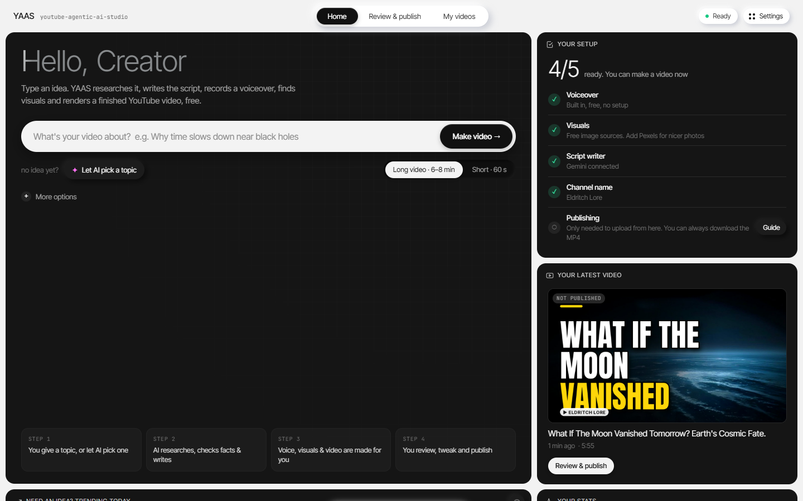
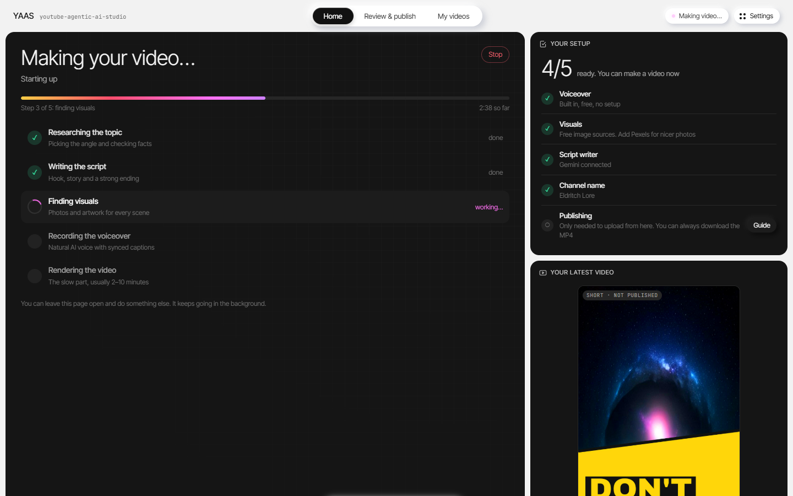
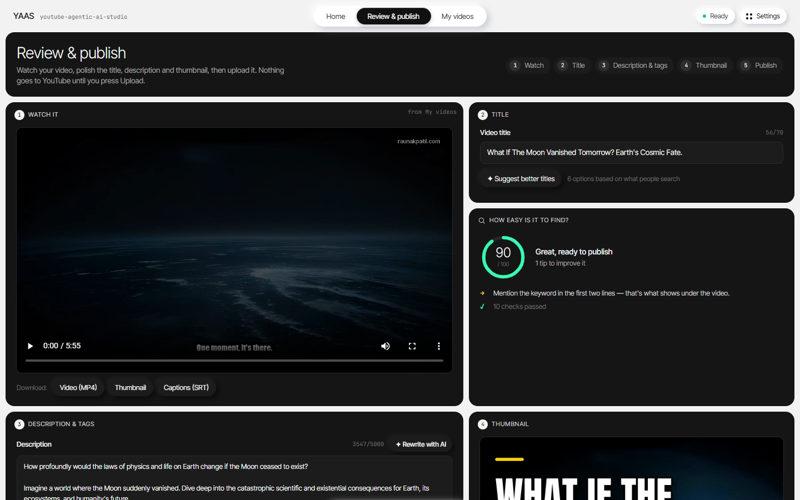
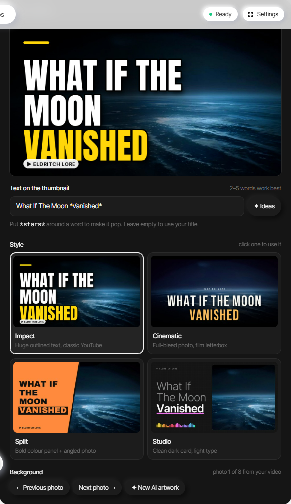
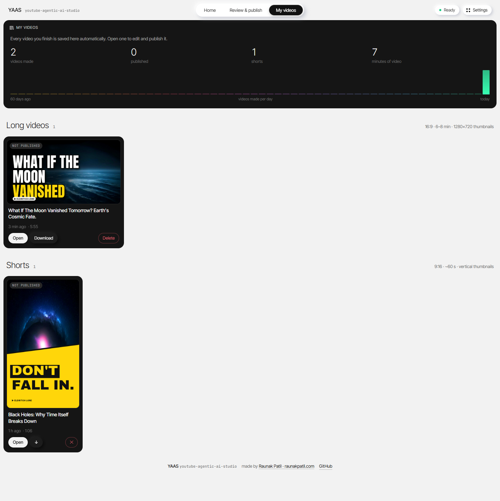
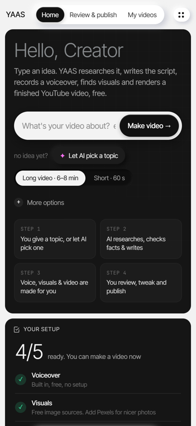
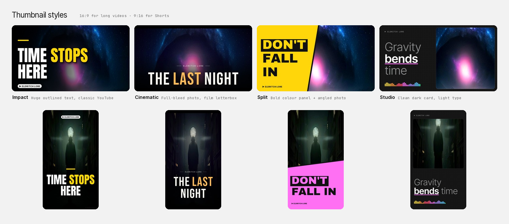

<div align="center">

# YAAS — youtube-agentic-ai-studio

**Type an idea. Get a finished, fact-checked YouTube video. Free.**

YAAS researches a topic, checks the facts, writes the script, records a voiceover, finds visuals, renders the video, and helps you title, tag and publish it, all from one simple local app.

[](https://python.org)
[](LICENSE)
[](SETUP.md)
[](#-the-free-api-stack)
[](https://github.com/raunakpatil/youtube-agentic-ai-studio/actions/workflows/tests.yml)
[](https://github.com/raunakpatil/youtube-agentic-ai-studio/stargazers)

[**Quick start**](#-quick-start) · [**How it works**](#-how-it-works) · [**Free APIs**](#-the-free-api-stack) · [**Setup guide**](SETUP.md) · [**FAQ**](#-faq)

</div>

---

## ⚡ Quick start

```bash
git clone https://github.com/raunakpatil/youtube-agentic-ai-studio.git
cd youtube-agentic-ai-studio
pip install -r requirements.txt
python gui.py          # opens http://localhost:7070
```

Then type a topic on the Home screen and press **Make video**. That's it.

No keys are required to try it. A free [Gemini key](https://aistudio.google.com/apikey) (1 minute to get) makes the scripts much better. Paste it in **Settings** and it's stored locally in `.env`. Uploading straight to YouTube needs a one-time Google setup, covered in the [Setup guide](SETUP.md). You can always download the MP4 and upload it yourself instead.

---

## 🧭 How it works

The app has three screens, in the order you use them:

| Screen | What you do there |
|---|---|
| **Home** | Type a topic, or press **Let AI pick a topic**, or click a **trending idea**. Choose long video or Short. Watch plain-English progress: *researching → writing → finding visuals → recording voice → rendering*. |
| **Review & publish** | Five numbered steps: **1** watch it, **2** polish the title (or let AI suggest 6 better ones), **3** edit description & tags (with real YouTube search suggestions), **4** make a thumbnail (photo or new AI artwork), **5** upload now or schedule. A live *How easy is it to find?* score tells you what to fix. |
| **My videos** | Every finished video is saved automatically, with **Long videos** and **Shorts** in separate sections. Re-open, re-edit, re-publish, download or delete. |

**Settings** (top right) holds your channel name, voice, optional keys and advanced options. Everything has a sensible default.

<table>
<tr>
<td width="50%"><br><sub><b>Home</b>: type an idea, or let AI pick one</sub></td>
<td width="50%"><br><sub><b>Making a video</b>: plain-English progress, step by step</sub></td>
</tr>
<tr>
<td width="50%"><br><sub><b>Review &amp; publish</b>: watch, title, findability score</sub></td>
<td width="50%"><br><sub><b>Thumbnail designer</b>: text, 4 styles, any background</sub></td>
</tr>
<tr>
<td width="50%"><br><sub><b>My videos</b>: long videos and Shorts kept apart</sub></td>
<td width="50%" align="center"><br><sub><b>Works at phone width</b></sub></td>
</tr>
</table>



Behind the scenes:

```
topic ──► Research ──► Fact-check ──► Script ──► Visuals ──► Voice ──► Render ──► Review ──► Publish
          (AI +        (Wikipedia    (AI)       (Pexels →   (Edge     (MoviePy)   (title lab,  (YouTube
          trends)       + arXiv)                 NASA → …)   TTS)                  SEO score)   API)
```

---

## ✨ Features

| | |
|---|---|
| 🧠 **Trend-aware topics** | Live ideas from Google Trends, Wikipedia, Hacker News, Spaceflight News and arXiv. Click one, or let the AI ride a trend that fits your niche. |
| 📚 **Fact-checked scripts** | Before writing, YAAS pulls background from Wikipedia and arXiv, tells the AI not to contradict it, and lists the sources in your description. |
| ✍️ **Never-stuck AI** | Gemini model chain → Groq → OpenRouter → Pollinations (keyless), so a quota error doesn't kill the run. Broken JSON from models is repaired automatically. |
| 🖼️ **Visuals without a key** | Pexels → Pixabay → NASA (public domain, space topics) → Openverse (CC, credited) → AI-generated images. Credits are written into the description for you. |
| 🎙️ **Free voice** | Microsoft Edge neural voices with word-synced captions. |
| 🎞️ **Long videos & Shorts** | 16:9 with chapters, Ken Burns motion and B-roll cuts, or 9:16 Shorts with big captions. Each format gets matching thumbnails and its own section in My videos. |
| 🏷️ **Your brand** | Your channel name appears in the intro, on Shorts and on thumbnails. Change the text or switch it off in Settings. |
| ✦ **Title Lab** | 6 alternative titles written from what people actually search, each scored. |
| 🔎 **Findability score** | 11 checks based on YouTube best practice (length, keyword placement, chapters, tags, hashtags, call to action), each with a tip. |
| 🔤 **Keyword ideas** | Real YouTube autocomplete suggestions + related terms, one click to add as tags. |
| 🖌️ **Thumbnail designer** | 4 styles (Impact, Cinematic, Split, Studio) with live previews, short punchy text with a highlighted word, AI text ideas, and any photo from the video or brand-new AI artwork as the background. 1280×720 for long videos, 1080×1920 for Shorts, always under YouTube's 2 MB limit. |
| 📅 **Schedule uploads** | Upload now or pick a time. Downloads for MP4, thumbnail and captions (SRT). |
| 📊 **Your stats** | Production history, plus live subscribers and views per upload with a free YouTube Data API key. |
| 🗂️ **My videos** | Every render archived with its script, sources, photos and metadata. |
| ©️ **Credits** | Every video carries a semi-transparent **raunakpatil.com** watermark, and descriptions end with *Made with YAAS by Raunak Patil · raunakpatil.com*. |
| 🎵 **Background music** | Drop MP3s in `music library/` and they're shuffled and looped to fit. |

---

## 🔌 The free API stack

Everything below is free. **Keyless** ones work out of the box; the others need a free sign-up and are optional.

| Service | Used for | Key |
|---|---|---|
| Google Gemini | Research, scripts, titles | free key, recommended |
| Groq | Fast backup AI | free key, optional |
| OpenRouter | Backup AI (free models) | free key, optional |
| Pollinations (text) | Last-resort backup AI | keyless |
| Edge TTS | Neural voiceover | keyless |
| Pexels | Stock photos | free key, optional |
| Pixabay | Stock photos | free key, optional |
| NASA Image Library | Public-domain space imagery | keyless |
| Openverse | Creative Commons images (credited) | keyless |
| Pollinations (image) | AI B-roll & thumbnail art | keyless |
| Wikipedia | Fact-checking + trending ideas | keyless |
| arXiv | Fact-checking + new research ideas | keyless |
| Google Trends RSS | Search spikes | keyless |
| Hacker News (Algolia) | Tech trends | keyless |
| Spaceflight News API | Space & science news | keyless |
| YouTube autocomplete | Keyword research | keyless |
| Datamuse | Related keywords | keyless |
| YouTube Data API | Channel stats | free key, optional |
| YouTube upload (OAuth) | Publishing | one-time setup |

Home → **Connected services → Test connections** pings every service and shows what's working.

> Free, keyless services can rate-limit or change without notice. YAAS retries, then falls through to the next source, and the run only fails if every option for a step is down.

---

## 🔑 Keys and settings

Keys live in `.env` (git-ignored) and nothing else stores them. Either paste them in **Settings** or copy `.env.example`:

```bash
cp .env.example .env
```

Non-secret settings (voice, channel description, video style) are saved to `config.py`, which is also documented line by line.

---

## 📁 Project structure

```
├── gui.py                  ← run this: the app (Flask, http://localhost:7070)
├── pipeline.py             ← headless CLI version of the pipeline
├── config.py               ← every setting, documented (+ .env loader)
├── .env.example            ← copy to .env for your keys
│
├── apis/                   ← free API integrations (all fail-soft)
│   ├── trends.py           ← Google Trends, Wikipedia, HN, Spaceflight News, arXiv
│   ├── knowledge.py        ← Wikipedia + arXiv fact grounding
│   ├── seo.py              ← YouTube autocomplete, Datamuse, findability score
│   ├── images.py           ← Pixabay, NASA, Openverse, Pollinations
│   ├── llm.py              ← Groq → OpenRouter → Pollinations fallback
│   └── youtube_stats.py    ← public channel stats
│
├── agents/
│   ├── gemini_client.py    ← Gemini model chain + fallback hand-off
│   ├── json_utils.py       ← repairs broken JSON from models
│   ├── researcher.py       ← topic research (trend-aware, grounded)
│   └── scriptwriter.py     ← script writing
│
├── video/
│   ├── narrator.py         ← Edge TTS voiceover + captions
│   ├── stock.py            ← image download chain + credits
│   ├── creator.py          ← renderer (Ken Burns, captions, Shorts, watermark)
│   ├── thumbnail.py        ← thumbnail designer (4 styles, 16:9 + 9:16)
│   ├── fonts.py            ← Google Fonts download + fallbacks
│   └── music.py            ← background music mixer
│
├── uploader/youtube.py     ← YouTube upload (used by pipeline.py)
├── gui_templates/index.html← the whole UI
├── tests/                  ← pytest suite (offline, no keys needed)
├── docs/screenshots/       ← README images
└── output/                 ← generated files (git-ignored)
    └── library/            ← every finished video, archived
```

---

## 🧪 Running the tests

```bash
pip install pytest
pytest
```

The suite runs offline with no API keys. It covers JSON repair, the findability score, every thumbnail style in both shapes, descriptions and credits, the watermark, `.env` handling and the AI model chain. GitHub Actions runs it on every push and pull request.

---

## ❓ FAQ

<details>
<summary><b>Does this cost anything?</b></summary>

No. Every service has a free tier or needs no account, and rendering runs on your own machine.
</details>

<details>
<summary><b>Do I need any API keys?</b></summary>

Not to try it. Without keys, scripts come from the keyless backup AI and visuals from NASA / Openverse / AI images. A free Gemini key is strongly recommended for script quality and reliability.
</details>

<details>
<summary><b>How long does one video take?</b></summary>

Research and script take under a minute. A Short renders in a few minutes; a 6–8 minute video in roughly 3–10 minutes depending on your CPU and the *Render quality* setting.
</details>

<details>
<summary><b>The voiceover step fails with a 403 error</b></summary>

Microsoft periodically changes its free speech service. Update the voice library: `pip install -U edge-tts`.
</details>

<details>
<summary><b>Can I use it without uploading to YouTube?</b></summary>

Yes. Download the MP4, thumbnail and captions from **Review & publish** and upload them however you like.
</details>

<details>
<summary><b>Can I turn off the raunakpatil.com watermark?</b></summary>

No. The small semi-transparent watermark is part of every video YAAS renders, as credit for the free tool. The description credit line can be switched off in **Settings → Music & publishing**.
</details>

<details>
<summary><b>Why is moviepy pinned to 1.0.3?</b></summary>

MoviePy 2.x removed `moviepy.editor` and changed the API, and NumPy must stay below 2.0 for it. Don't upgrade either.
</details>

<details>
<summary><b>The video has tiny or ugly text</b></summary>

Your system is missing the fonts the renderer looks for. Install DejaVu (`sudo apt install fonts-dejavu` on Ubuntu). Windows already has them.
</details>

<details>
<summary><b>YouTube upload fails with "access denied"</b></summary>

Delete `youtube_token.pickle` and upload again to redo sign-in. Make sure your Google account is a **Test user** on the OAuth consent screen.
</details>

---

## 🗺️ Roadmap

- [x] Thumbnail designer (4 styles, AI text ideas, AI artwork)
- [x] Scheduled uploads
- [x] Analytics (channel stats + production history)
- [x] Trend-aware topics and fact-checked scripts
- [ ] Stock video B-roll (Pexels / Pixabay video)
- [ ] Multi-channel profiles
- [ ] Custom intro/outro clips
- [ ] Caption upload to YouTube

---

## 🎬 Made with YAAS

**[Eldritch Lore](https://www.youtube.com/@EldritchLore)** runs on this pipeline: science, history and "what if" videos. Also see **[The Fractured Timelines](https://www.youtube.com/@TheFracturedTimelines)**.

## 🤝 Contributing

Pull requests welcome. Open an issue first for big changes. See [CONTRIBUTING.md](CONTRIBUTING.md).

<div align="center">

Made by <a href="https://raunakpatil.com">Raunak Patil</a> · UI styled after <a href="https://raunakpatil.com">raunakpatil.com</a>

</div>
